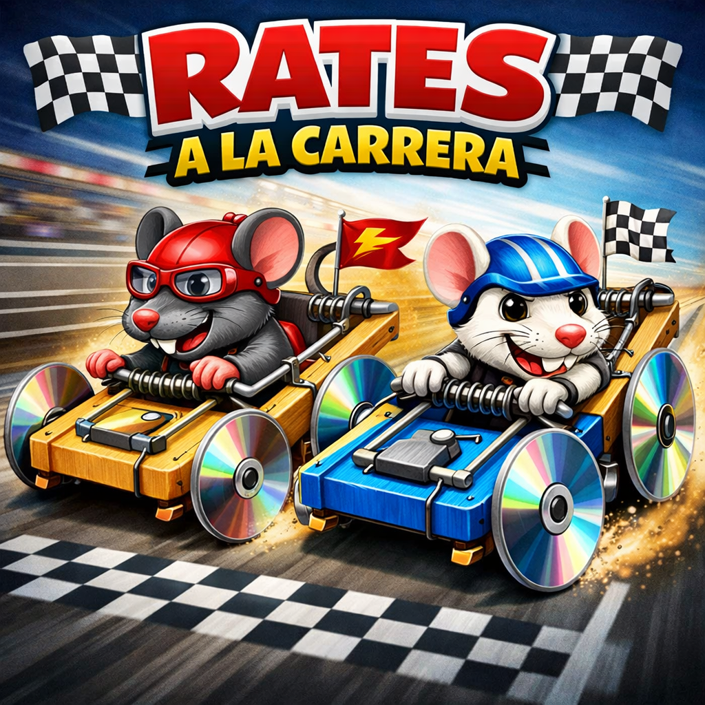
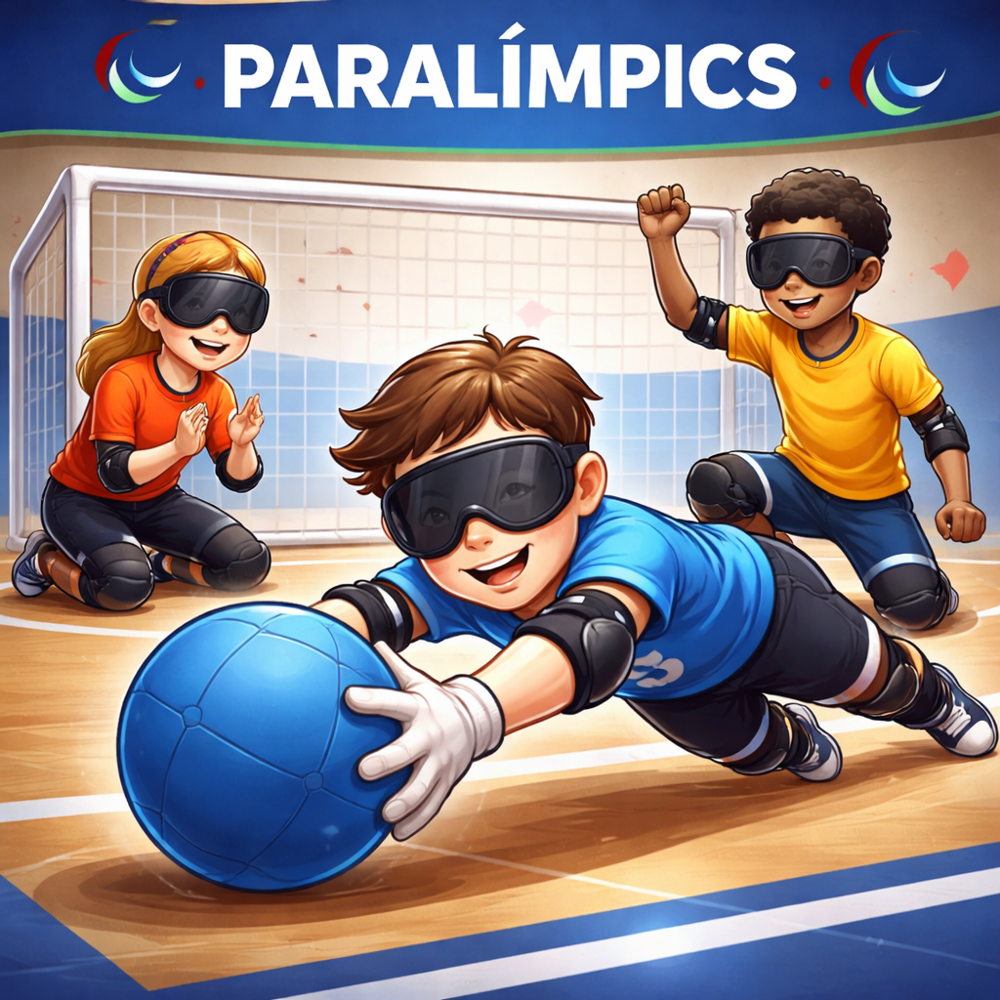
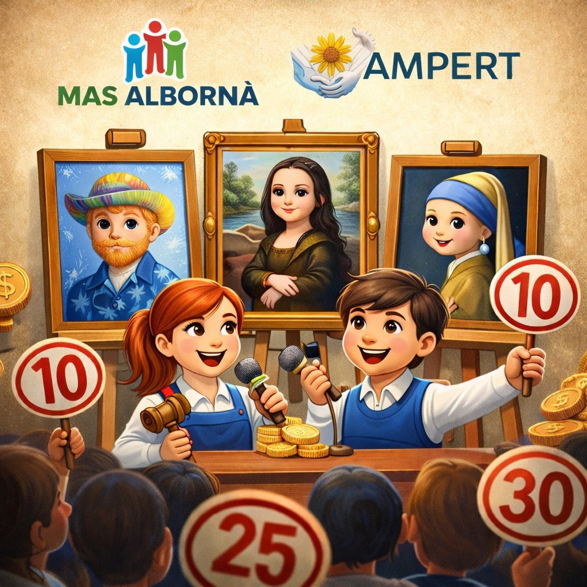
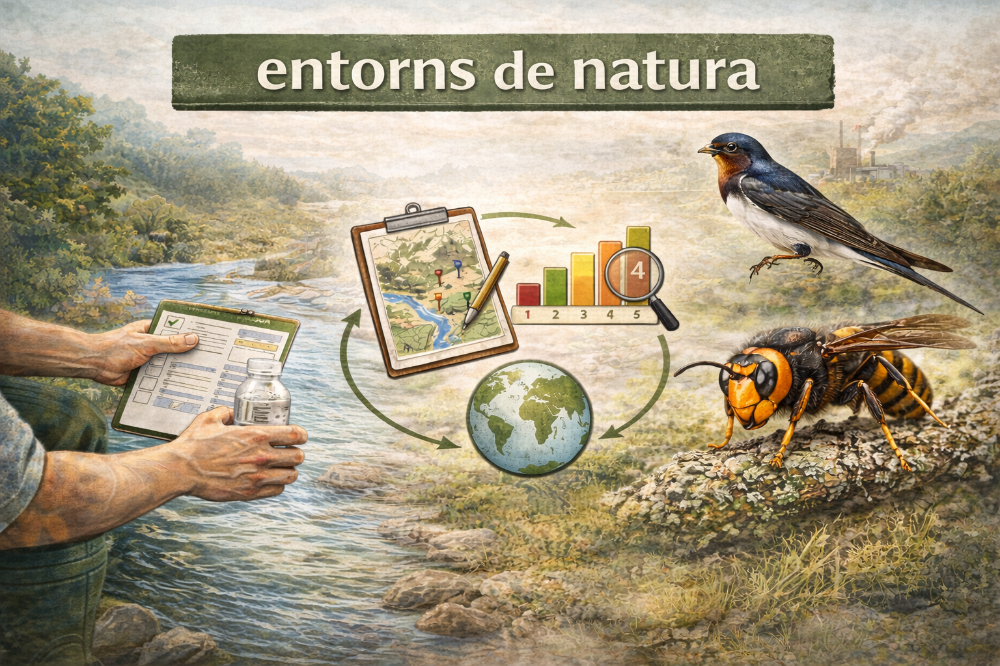
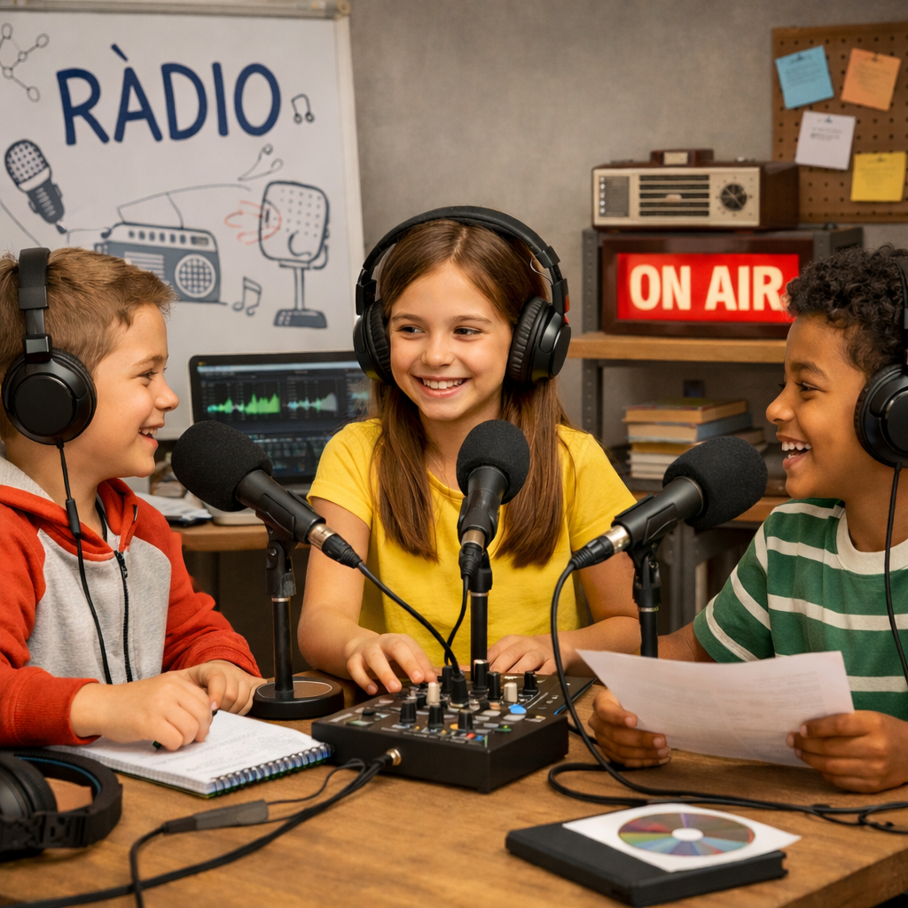
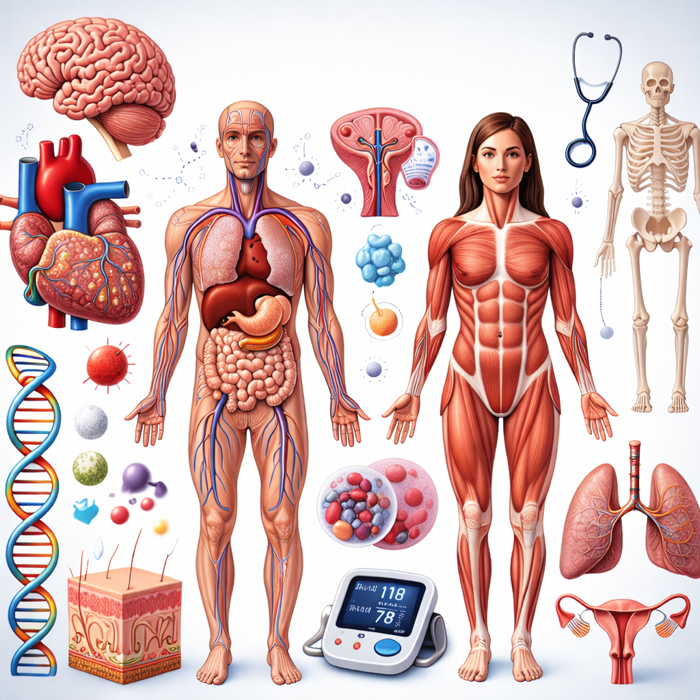

# Aula CreActiva

**Aula CreActiva** és un grup de professors de l'INS Institut Intermunicipal del Penedès (Sant Sadurní d'Anoia, Alt Penedès, Catalunya) que treballa per transformar l’educació i millorar els **aprenentatges competencials** de l’alumnat de l'ESO i Batxillerat.

Actualment, l'Aula CreActiva se centra en tres grans àmbits:

1. **Manteniment, millora i actualització de tots els projectes de l'Institut**
2. **Acompanyament del professorat en l’avaluació de les competències transversals a tota l’ESO**
3. **El desenvolupament d’una web app educativa** per ajudar l’alumnat a treballar continguts, activitats i reptes vinculats a diferents projectes i matèries.

---

## WEB APP

Aquesta web app és un entorn educatiu digital que recull activitats, jocs, recursos i materials per treballar diferents sabers i competències de manera més activa, aplicada i motivadora.

No és només un repositori de continguts, sinó una eina per:

- reforçar aprenentatges
- practicar competències
- estructurar activitats de projecte
- oferir materials interactius a l’alumnat
- connectar àrees, contextos i situacions d’aprenentatge

---

## Tipus d'activitats

La web combina diferents formats d'activitat perquè l'alumnat pugui practicar sabers i competències de maneres diverses:

- **Preguntes tipus quiz**: activitats de resposta única o opcions múltiples, amb feedback i puntuació.
- **Preguntes amb imatge**: identificació d'elements visuals com connectors, parts del cos, espècies, quadres o mapes.
- **Classificació de preguntes**: decidir si una pregunta és investigable o no, detectar problemes i millorar-ne el plantejament.
- **Selecció de preguntes bones**: triar, dins d'un tema, quines preguntes són adequades per investigar.
- **Ordenació de conceptes o fases**: posar en ordre processos, accions, idees o seqüències d'una activitat.
- **Arrossegar i relacionar**: vincular conceptes amb definicions, parts amb noms o elements amb la seva categoria.
- **Activitats de mapes i localització**: treballar capitals, geografia, espais i relacions territorials.
- **Reconeixement i anàlisi**: observar imatges, interpretar dades, identificar rols ecològics o resoldre reptes contextualitzats.
- **Activitats de bibliografia i recerca**: practicar citacions, fonts, temes de recerca i formulació de bones preguntes.
- **Simulacions i reptes guiats**: activitats com la genètica mendeliana, amb encreuaments, quadres de Punnett, autocorrecció i resultats guardats.
- **Reptes digitals i tecnològics**: activitats vinculades a àudio, ràdio, micro:bit i eines digitals.

---

## Projectes principals de la web app

La web inclou activitats relacionades amb diversos projectes educatius de l’ESO, entre els quals destaquen:

### 1ESO - Projecte "Rates a la carrera"

Projecte amb activitats i recursos específics per treballar continguts i dinàmiques pròpies d’aquest entorn de treball.

### 1ESO - Projecte "Mediterrani"

Projecte amb activitats vinculades a continguts geogràfics, culturals i d’anàlisi del món mediterrani.

### 2ESO - Projecte "Paralímpics"

Projecte amb activitats relacionades amb l’esport, la inclusió, la tecnologia i altres aspectes educatius vinculats als Jocs Paralímpics.

### 3ESO - Projecte "Solidart"

Projecte orientat a activitats creatives, artístiques i de sensibilització, amb diferents recursos dins la web.

### 4ESO - Projecte "Entorns de Natura"

Projecte amb activitats relacionades amb el medi natural, la investigació, els rols de treball i l’anàlisi d’entorns.

---

## Altres àmbits i seccions de la web

A més dels projectes principals, la web app també incorpora activitats i recursos per a altres àrees i matèries, com ara:

### 2ESO - Optativa "Ràdio"

Activitats relacionades amb llenguatge radiofònic, connectors, àudio i producció de continguts.

### 2ESO - "Biologia"

Recursos i activitats per treballar continguts de biologia de manera visual i interactiva.

### 4ESO - Optativa "Digitalització"

Activitats orientades al desenvolupament de la competència digital i a l’ús d’eines tecnològiques.

### BAT - Treball de recerca de Batxillerat

Materials i activitats per ajudar l’alumnat a pensar preguntes investigables, enfocar temes, treballar bibliografia i estructurar millor el procés de recerca.

---

## Finalitat pedagògica

La web app s’emmarca dins la voluntat d’Aula CreActiva de promoure:

- aprenentatges competencials
- activitats contextualitzades
- treball interdisciplinari
- recursos digitals útils per a l’aula
- una educació més activa, connectada i significativa

---

## Instruccions

1. Els alumnes accedeixen amb el seu correu de l'escola i una contrasenya.
2. Se'ls activa els projectes en funció del curs que estan.
3. Dins de cada projecte, hi ha activitats creades per treballar diferents aspectes.
4. Les activitats serveixen per consolidar les aprenentatges i es poden fer diverses vegades.
5. Totes les puntuacions de les activitats es poden recuperar per utilitzar-les per la qualificació.

---

## Espai de professorat

Els usuaris amb rol de professorat o administració veuen un espai propi al dashboard amb eines de suport a l'aula i a l'avaluació.

La web també incorpora un recull d'eines per al professorat: orientacions per fer les programacions, recursos de metodologies actives, una pissarra digital i QPlay, una eina tipus Kahoot per crear dinàmiques de preguntes a l'aula.

- **Eines de professorat**: accés ràpid a Programacions, Metodologies actives, Pissarra digital i QPlay.
- **Full de resultats**: permet seleccionar matèria i grup, copiar la fórmula de consulta i crear un Google Sheet nou amb els resultats filtrats.
- **Google Sheet**: enllaç directe al full de dades principal de l'app.
- **Llista d'alumnes**: des del panell de resultats es pot crear un full nou amb nom, cognoms, email i grup dels alumnes del grup seleccionat.

Els grups disponibles es llegeixen de la pestanya `resultats`, prioritzant la columna `grup` i fent servir `curs` com a alternativa si cal.

---

## Backend i dades

La web és estàtica, però les dades viuen en un Google Sheet i es consulten a través d'un backend fet amb Google Apps Script.

Les preguntes, respostes i moltes dades de les activitats estan organitzades en pestanyes del Google Sheet. Això fa que els materials siguin fàcilment millorables: es poden corregir preguntes, afegir-ne de noves, ajustar respostes o ampliar activitats des del full de càlcul, sense haver de modificar directament el codi de la web.

- `api/Code.js`: API principal. Gestiona login, projectes, preguntes, resultats i eines de professorat.
- `api/appsscript.json`: manifest de permisos del projecte Apps Script.
- Pestanyes principals del Sheet: `usuaris`, `resultats` i les pestanyes de preguntes de cada activitat.
- Accions rellevants per al professorat: `getResultGroups`, `createResultsSheet` i `createGroupStudentsSheet`.

Quan es modifiqui `api/Code.js` o el manifest, cal tornar a desplegar l'Apps Script com a Web App perquè els canvis arribin a la web publicada.
