# Laboratori de formulació

Aplicació web per aprendre a formular i a anomenar compostos inorgànics segons les recomanacions de la IUPAC del 2005, en català. Està pensada per a 3r i 4t d'ESO, amb un nivell opcional de batxillerat.

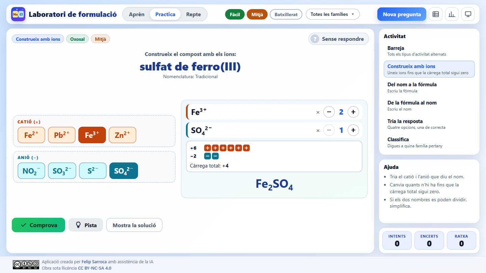

## Índex

- [Què ofereix](#què-ofereix)
- [Mode Aprèn](#mode-aprèn)
- [Mode Practica](#mode-practica)
- [Missatges, pistes i solució](#missatges-pistes-i-solució)
- [Mode Repte](#mode-repte)
- [Quadern de formulació](#quadern-de-formulació)
- [Criteris de nomenclatura](#criteris-de-nomenclatura)
- [Adaptació a la pantalla](#adaptació-a-la-pantalla)
- [Ús a l'aula](#ús-a-laula)
- [Estructura del projecte](#estructura-del-projecte)
- [Execució local](#execució-local)
- [Afegir o modificar compostos](#afegir-o-modificar-compostos)
- [Llicència](#llicència)

## Què ofereix

- **660 compostos** generats a partir d'una taula d'ions i de llistes revisades. Tots es validen automàticament. Es reparteixen en tres nivells:

  | Nivell | Compostos | Curs | Contingut |
  |---|---|---|---|
  | Fàcil | 211 | 3r d'ESO | Substàncies simples, òxids, hidrurs, sals binàries i compostos entre no-metalls |
  | Mitjà | 261 | 4t d'ESO | Hidròxids, oxoàcids i oxosals |
  | Batxillerat | 188 | 1r de batxillerat | Peròxids, sals àcides, oxoanions del brom, del iode, del crom, del manganès i del seleni, i nomenclatura d'hidrogen |

- **Deu famílies**, que es poden filtrar:

  | Família | Compostos | Família | Compostos |
  |---|---|---|---|
  | Substàncies simples | 18 | Peròxids | 8 |
  | Òxids | 49 | Hidròxids | 28 |
  | Hidrurs | 18 | Oxoàcids | 24 |
  | Sals binàries | 125 | Oxosals | 324 |
  | Compostos entre no-metalls | 12 | Sals àcides | 54 |

- **Tres modes**: Aprèn (teoria en 8 mòduls), Practica (lliure, amb pistes i solució) i Repte (10 preguntes puntuades).
- **Cinc tipus d'activitat** i una barreja de totes.
- **Correcció pedagògica**: l'app no diu només «incorrecte», sinó *què* falla (falten parèntesis, falta el nombre d'oxidació, sobra un prefix…).
- **Química de cada dia**: molts compostos porten una nota d'on es troben (guix, salfumant, lleixiu, bicarbonat…). Es mostra quan s'encerta.
- **Sense dependències ni registre**: no cal cap compte i tot es desa al navegador.

## Mode Aprèn

Vuit mòduls amb la teoria imprescindible, exemples i errors freqüents. Cada mòdul acaba amb el botó **Practica aquest mòdul**, que obre el mode Practica amb el filtre de famílies corresponent.

| Mòdul | Contingut | Nivell |
|---|---|---|
| 0. Les peces del joc | Ions, càrregues, nombre d'oxidació i regla de la neutralitat | Fàcil |
| 1. Substàncies simples | Metalls, molècules diatòmiques, O₃, P₄, S₈ | Fàcil |
| 2. Compostos binaris | Òxids, hidrurs, sals binàries, compostos entre no-metalls i peròxids | Fàcil |
| 3. Hidròxids | L'ió OH⁻ i els parèntesis | Mitjà |
| 4. Oxoàcids | Taula d'àcids (hipo-…-ós, -ós, -ic, per-…-ic) | Mitjà |
| 5. Oxosals | De l'àcid a la sal: -ós → -it, -ic → -at | Mitjà |
| 6. Ions poliatòmics | Amoni, oxidani i taula d'anions | Mitjà |
| 7. La química de cada dia | Galeria de compostos quotidians | Fàcil |

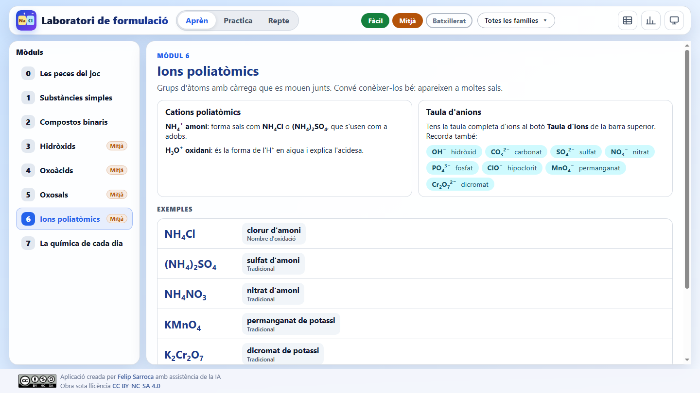

## Mode Practica

| Activitat | Què fa l'alumne |
|---|---|
| **Construeix amb ions** | Tria el catió i l'anió i ajusta quants n'hi ha. Un comptador mostra les càrregues positives i negatives i la fórmula es construeix en directe. |
| **Del nom a la fórmula** | Escriu la fórmula. Els subíndexs s'escriuen com a números normals i una previsualització mostra com es llegeix. |
| **De la fórmula al nom** | Escriu el nom amb qualsevol nomenclatura acceptada. Un teclat petit ajuda amb els accents, la ela geminada, els parèntesis i les xifres romanes. |
| **Tria la resposta** | Quatre opcions amb distractors versemblants: subíndexs canviats, parèntesis oblidats, terminació equivocada… |
| **Classifica** | Diu a quina família pertany el compost. |
| **Barreja** | Alterna totes les activitats. |

Les preguntes es filtren per nivell (botons de colors de la barra superior) i per família (menú desplegable). El 30 % de les preguntes es trien entre els compostos de la vida quotidiana.

| Tria la resposta | Classifica |
|---|---|
| 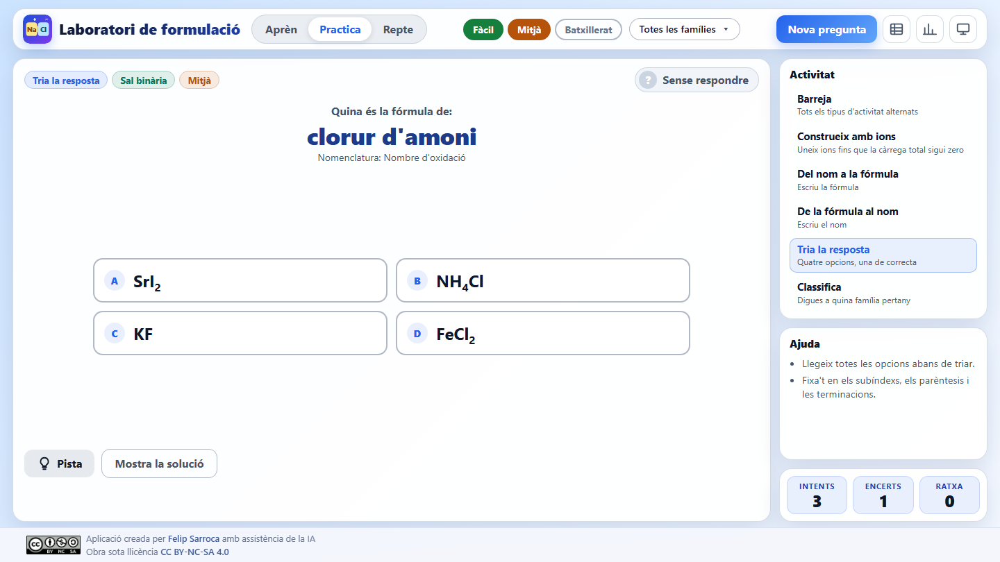 | 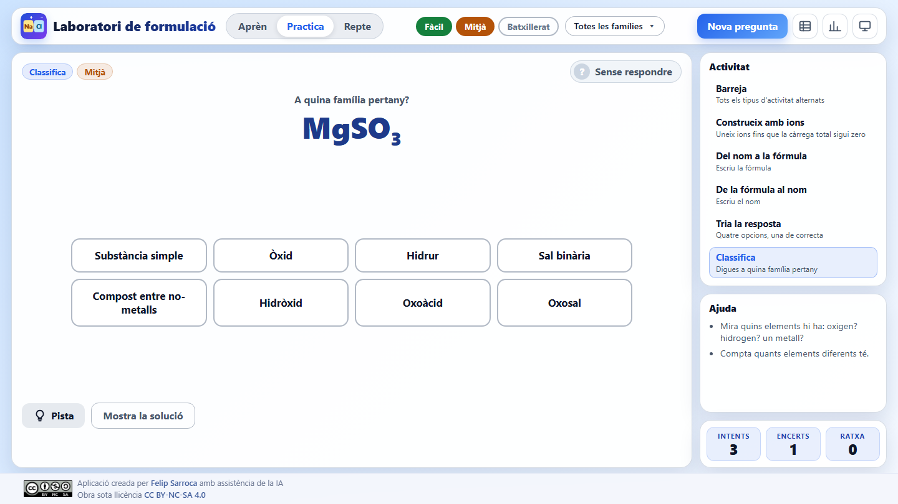 |

## Missatges, pistes i solució

Quan la resposta no és correcta, l'app intenta diagnosticar l'error:

| Error | Exemple de missatge |
|---|---|
| Falten parèntesis | «Falten els parèntesis: quan hi ha més d'un ió poliatòmic, el grup va entre parèntesis, com a Fe₂(SO₄)₃.» |
| Falta el nombre d'oxidació | «Falta el nombre d'oxidació: el cobalt pot actuar amb diverses càrregues.» |
| Nombre d'oxidació equivocat | Recorda que ha de coincidir amb la càrrega del catió |
| Majúscules | Recorda que cada símbol comença amb majúscula: Co és cobalt; CO, carboni i oxigen |
| Fórmula no simplificada | Diu per quin nombre cal dividir els subíndexs |
| Nom d'un altre compost | Diu a quina fórmula correspon el nom que s'ha escrit |
| Terminació -at / -it | Recorda la relació amb l'oxoàcid |

| Del nom a la fórmula | De la fórmula al nom |
|---|---|
| 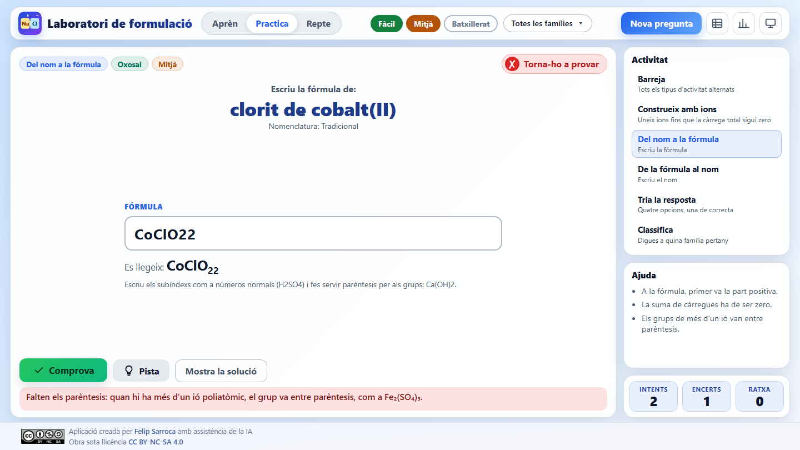 | 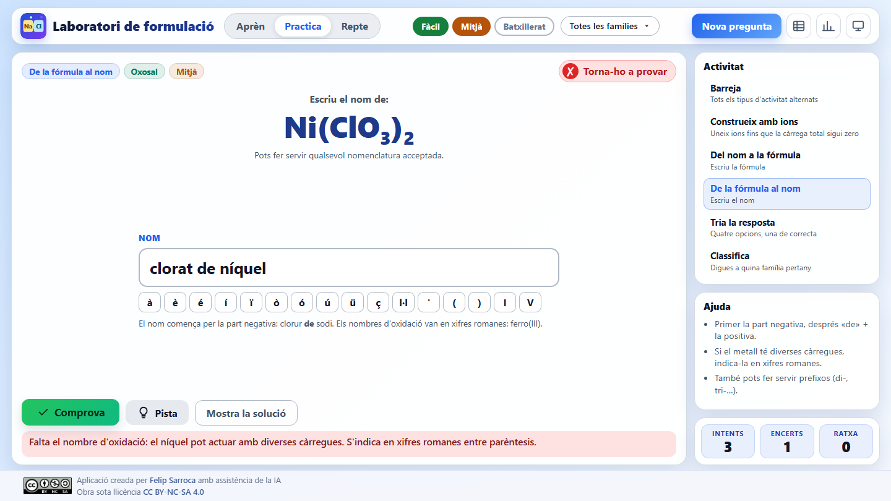 |

A més:

- **Pistes en tres passos**, de més generals a més concretes.
- **Mostra la solució**: ensenya la resposta, però no compta com a encert i reinicia la ratxa.
- **Fitxa del compost**: en acabar, el panell d'ajuda mostra tots els noms acceptats, amb la nomenclatura de cadascun, i on es troba el compost.

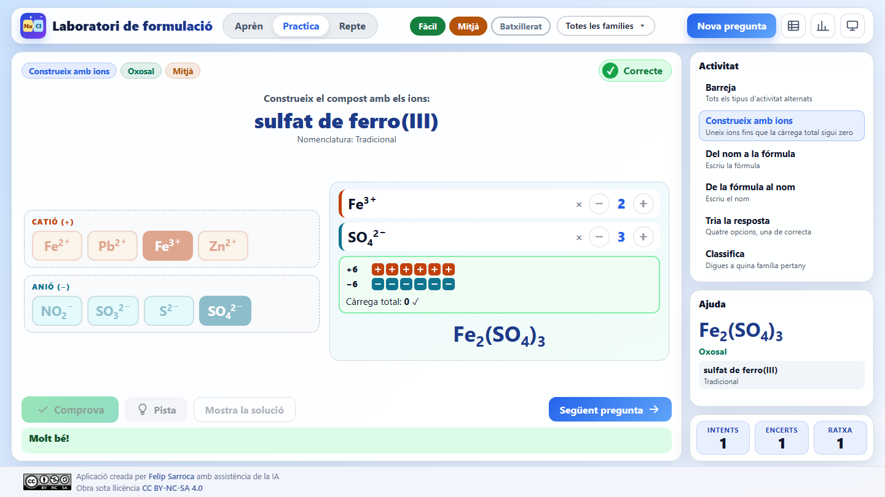

## Mode Repte

- 10 preguntes de tipus variat amb els filtres actius.
- Dos intents per pregunta, sense pistes ni solució.
- Encertar a la primera val 2 punts; a la segona, 1.
- En acabar es mostren els punts i fins a tres estrelles (90 %, 70 % i 40 %).

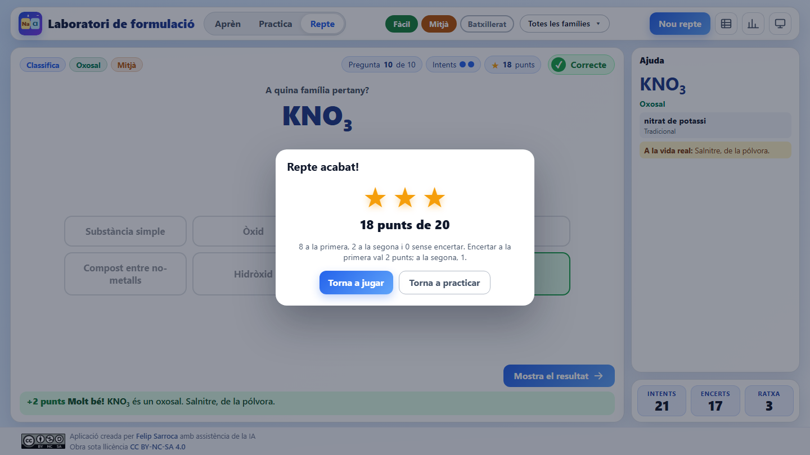

## Quadern de formulació

Els botons de la barra superior obren el quadern, amb dues pestanyes:

- **Taula d'ions**: cations i anions de cada nivell, amb la càrrega i el nom.
- **El meu progrés**: compostos resolts, encerts, precisió i millor ratxa, progrés per nivell i per família. Es pot esborrar el progrés.

| Taula d'ions | El meu progrés |
|---|---|
| 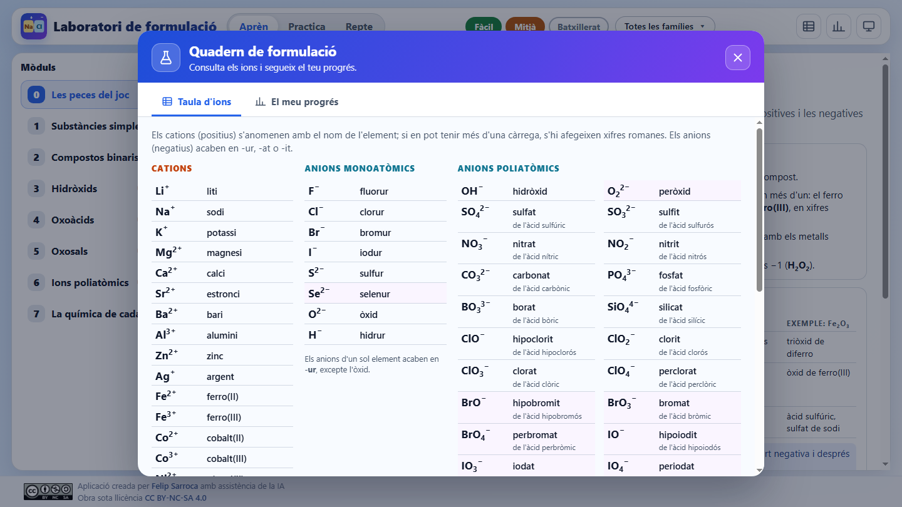 | 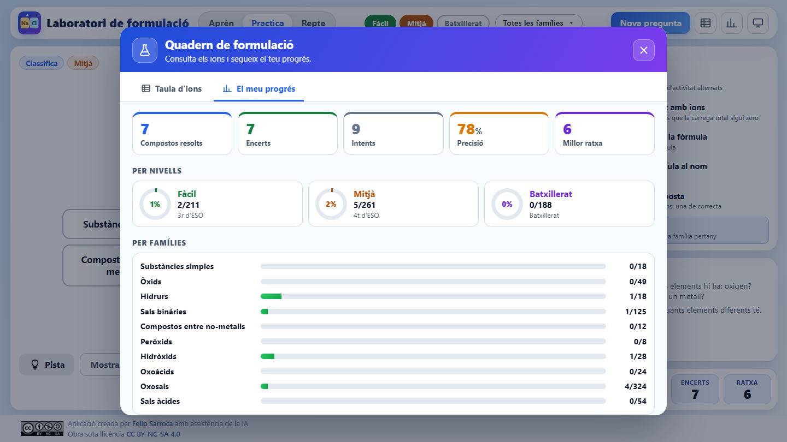 |

## Criteris de nomenclatura

| Nomenclatura | On s'accepta |
|---|---|
| Composició (prefixos multiplicadors) | Tots els compostos binaris i els hidròxids |
| Nombre d'oxidació (xifres romanes) | Tots els compostos iònics. El nombre només s'indica en els metalls amb més d'una càrrega habitual |
| Tradicional | Només oxoàcids i oxosals (àcid sulfúric, sulfat de sodi) |
| Hidrogen | Només al nivell de batxillerat: dihidrogen(tetraoxidosulfat) |

Altres criteris:

- Els oxoàcids i les oxosals del brom i del iode són de batxillerat. Els del clor són de 4t d'ESO.
- S'apostrofa davant de vocal i de h muda (d'alumini, d'hidrogen), però no davant de i consonàntica (de iode).
- Els prefixos no s'eliden davant d'òxid (diòxid, pentaòxid), excepte mono-, que fa monòxid.
- La correcció tolera els accents i les majúscules, però no la falta de nombre d'oxidació o de prefixos.
- Es mantenen alguns noms comuns acceptats per la IUPAC: aigua, amoníac i metà. També s'accepta *fosfina* al costat de fosfà.

## Adaptació a la pantalla

La interfície està pensada per a 1440 × 800 px i s'escala automàticament amb la variable `--ui-zoom` (vegeu `fitScale` a `js/app.js`). Tota l'activitat cap en una sola pantalla, sense desplaçament, a:

- 1920 × 1080 (s'amplia);
- 1366 × 768 i 1366 × 740 (es redueix);
- escalat del sistema al 125 % i al 150 %;
- tauleta (1024 × 768).

Hi ha dos casos especials:

- **Mode projector** (botó de la pantalla): fa servir una base més petita perquè tot es vegi més gran a la pissarra digital. Amaga les descripcions de les activitats i compacta la zona de construcció.
- **Mòbil** (menys de 900 px d'amplada): la disposició passa a una columna amb desplaçament vertical.

| Mode projector | Mòbil |
|---|---|
| 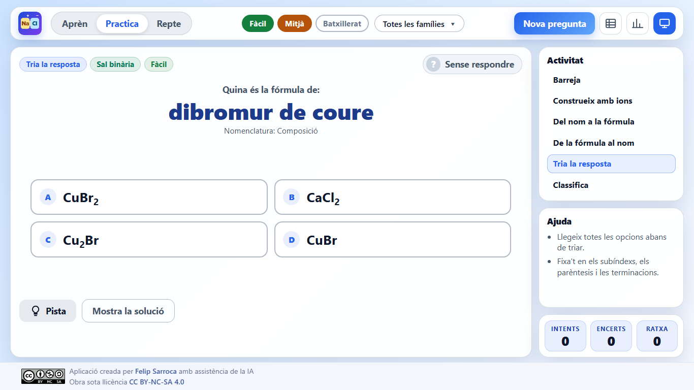 | 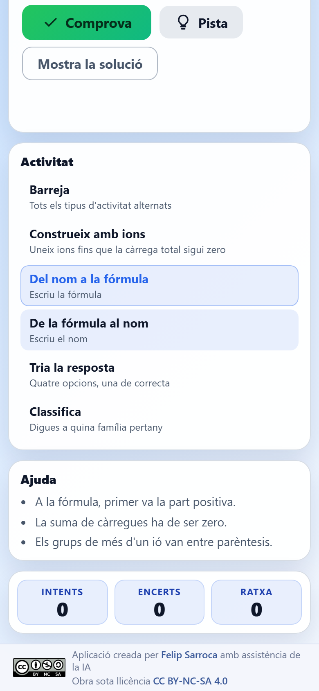 |

## Ús a l'aula

| Moment | Proposta |
|---|---|
| **Introducció** | Amb el mode projector, treballeu el mòdul 0 i feu «Construeix amb ions» col·lectivament: el comptador fa visible per què CaCl₂ porta un 2. |
| **Pràctica guiada** | L'alumnat treballa en parelles una sola família (per exemple, sals binàries) i passa a la següent quan la domina. |
| **Autonomia** | Activeu «Barreja» amb tots els filtres del curs. Les pistes ajuden sense donar la resposta. |
| **Avaluació formativa** | Cada alumne fa un Repte i lliura una captura del resultat a Google Classroom. «El meu progrés» mostra les famílies que cal reforçar. |
| **Atenció a la diversitat** | «Construeix amb ions» i «Tria la resposta» són accessibles per a l'alumnat nouvingut o amb NESE, perquè no cal escriure. El nivell de batxillerat permet ampliar per a l'alumnat d'altes capacitats. |

Connexió curricular (LOMLOE, currículum de Catalunya, Física i Química d'ESO): la formulació i la nomenclatura de substàncies simples i compostos binaris i ternaris segons les normes de la IUPAC.

## Estructura del projecte

```text
FormulacioInorganica/
├── index.html                # Estructura de la pàgina i diàlegs
├── INDEX.md                  # Índex de continguts i decisions de nomenclatura
├── css/styles.css            # Estils i adaptació a la pantalla
├── js/
│   ├── formula.js            # Lectura, validació i dibuix de fórmules
│   ├── nomenclatura.js       # Ions, famílies, nivells i generació del catàleg
│   ├── exercicis.js          # Correcció, diagnòstic d'errors, distractors i pistes
│   ├── aprenentatge.js       # Contingut dels mòduls del mode Aprèn
│   └── app.js                # Interfície, modes, repte i progrés
├── scripts/valida-dades.mjs  # Validació automàtica del catàleg
├── docs/                     # Captures del README
├── assets/CC_BY-NC-SA.png    # Distintiu de la llicència
└── favicon.svg
```

No depèn de cap biblioteca externa i funciona sense connexió un cop carregada.

El progrés es desa al `localStorage` del navegador amb tres claus:

| Clau | Contingut |
|---|---|
| `fi_settings_v1` | Nivells, famílies, activitat, mode projector, darrer mòdul i darrera pestanya del quadern |
| `fi_stats_v1` | Intents, encerts, ratxa actual i millor ratxa |
| `fi_progress_v1` | Compostos resolts (per fórmula) |

## Execució local

Cal un servidor web estàtic, perquè el navegador no carrega mòduls JavaScript des de `file://`. Des de la carpeta de l'app:

```bash
python -m http.server 8000
```

Després obriu `http://localhost:8000`.

## Afegir o modificar compostos

Els compostos iònics (sals, hidròxids, oxosals, sals àcides, peròxids) es generen combinant els ions de `js/nomenclatura.js`:

- `CATIONS`: símbol, càrrega, nom i nivell. Els metalls amb més d'una càrrega porten `variable: true` perquè el nom inclogui el nombre d'oxidació.
- `MONO_ANIONS` i `OXOANIONS`: fórmula, càrrega, nom de l'anió, nom de l'àcid i nivell. Per exemple:

  ```js
  ["NO3", -1, "nitrat", "àcid nítric", "nitr", 2],
  ```

Les substàncies simples, els òxids de no-metall, els compostos entre no-metalls i els hidrurs progenitors (amoníac, metà…) són llistes revisades a mà al mateix fitxer. El context quotidià és al mapa `CONTEXT`, amb la fórmula com a clau.

Després de qualsevol canvi, valideu el catàleg:

```bash
node scripts/valida-dades.mjs
```

L'script comprova:

- que totes les fórmules s'interpreten bé;
- que no hi ha fórmules repetides ni noms que corresponguin a dos compostos;
- que els compostos iònics són neutres i tenen els subíndexs mínims;
- que cada nom es corregeix com a correcte i cada fórmula també;
- que les preguntes de tria tenen prou distractors i cap és una resposta correcta.

## Llicència

[Creative Commons BY-NC-SA 4.0](https://creativecommons.org/licenses/by-nc-sa/4.0/deed.ca). Aplicació creada per [Felip Sarroca](https://ja.cat/felipsarroca) amb assistència de la IA.
